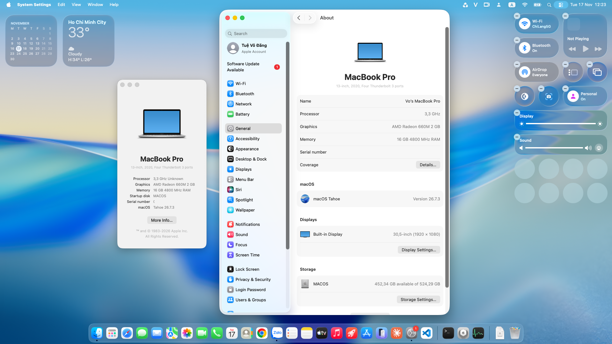

# MSI Bravo 15 B7ED — macOS Tahoe with AMD Radeon 660M acceleration

OpenCore EFI for the **MSI Bravo 15 B7ED** running **macOS Tahoe 26.7.3**, with a
hardware-accelerated AMD Radeon 660M iGPU (Metal and OpenGL), working audio,
built-in microphone, Wi-Fi and Bluetooth.

<p align="center"></p>

## Hardware

| Component | Model | Status |
|---|---|---|
| CPU | AMD Ryzen 5 7535HS (Rembrandt-R, 6C/12T) | ✅ |
| iGPU | AMD Radeon 660M (1002:1681), 2 GB UMA | ✅ Accelerated (Metal, OpenGL) |
| dGPU | AMD Radeon RX 6550M (Navi 24) | ❌ Disabled |
| Display | 15.6" 1920×1080 internal panel | ✅ Brightness, display sleep, hardware cursor |
| RAM | 16 GB DDR5-4800 | ✅ |
| Storage | WD PC SN560 1 TB (macOS) | ✅ |
| Wi-Fi | MediaTek MT7921 (RZ608) | ✅ |
| Bluetooth | MediaTek MT7921 | ✅ |
| Audio out | Realtek codec | ✅ Speakers, headphones |
| Microphone | AMD ACP 6.x digital microphone | ✅ |
| Keyboard / Touchpad | PS/2, I2C HID | ✅ |
| Ethernet | Realtek RTL8111 | ✅ |
| Battery | | ✅ |

## What works

- **iGPU acceleration** on the Radeon 660M: Metal 3 and OpenGL, shown as "AMD Radeon 660M" in System Information
- Brightness control, display sleep, hardware cursor
- Speakers, headphones and the built-in digital microphone
- Wi-Fi, Bluetooth, Handoff, Universal Clipboard
- Keyboard, touchpad, USB, Ethernet, battery status

## What doesn't work

| Feature | Note |
|---|---|
| Sleep | Disabled. The iGPU does not resume from S3. Closing the lid keeps the machine running with the display off |
| dGPU (RX 6550M) | Not supported |
| AirDrop, Sidecar (wireless) | The MediaTek Wi-Fi driver has no AWDL |
| External display (HDMI / USB-C) | Not supported |
| Docker Desktop / hardware virtualization | macOS has no hypervisor support on AMD CPUs |

## Installation

1. **BIOS**: set the iGPU memory (UMA frame buffer) to **2 GB**.
2. **EFI**: copy `EFI/` to your EFI partition.
3. **SMBIOS**: the config uses `MacBookPro16,2`. Generate your own serial, MLB, SystemUUID and ROM with [GenSMBIOS](https://github.com/corpnewt/GenSMBIOS) and fill them into `PlatformInfo > Generic` (they are blanked here as `GENERATE-WITH-GENSMBIOS`).
4. **After installing macOS**, install the framebuffer and microphone kexts into the Auxiliary Kernel Collection, then reboot:
   ```bash
   cd PostInstall
   sudo sh install-aux-kexts.sh
   ```
5. Keep the machine awake when the lid closes (S3 sleep is not usable):
   ```bash
   sudo pmset -a disablesleep 1
   ```

### Boot arguments

```
-v keepsyms=1 debug=0x100 alcid=5 revcpu=1 -rbgpunosentinel -rbgpuretirevbl
-rbgpufbhwcur -rbgpufbdpms -rbgpufaultpgtest -acpmic -acpmicnoreset
```

| Argument | Purpose |
|---|---|
| `alcid=5` | AppleALC layout |
| `-rbgpuretirevbl` | Frame retirement on vblank |
| `-rbgpufbhwcur` | Hardware cursor |
| `-rbgpufbdpms` | Display power off on display sleep |
| `-rbgpufaultpgtest` | GPU page-fault fix (stops OpenGL apps from hanging) |
| `-acpmic -acpmicnoreset` | Built-in microphone |
| `-rbgpunosentinel` | Optional. Remove it to have the GPU driver fall back to safe mode after a boot that fails in its first 60 s |
| `-v keepsyms=1 debug=0x100` | Optional. Verbose boot and debugging |

## Known issues

- **Do not force power off by holding the power button** unless the machine is frozen: on this laptop it can reset the BIOS UMA setting to 512 MB. Set it back to 2 GB if that happens.
- **Bluetooth disappears**: shut down, unplug the charger, wait 30 s, power on.
- **No sound in macOS and Windows**: the embedded controller is stuck. Shut down, unplug the charger, hold the power button for about 40 s while off, then power on (and re-check UMA).

## Kexts

| Kext | Source |
|---|---|
| RembrandtGPU (Lilu plugin) + RBAMDFramebuffer | [Radeonized](https://github.com/FranciumOS-org/Radeonized) (MIT), branch built for this machine |
| ACPMic | This repository: AMD ACP 6.x digital microphone driver |
| PCIPMManaged, XHCIPoll | This repository |
| Lilu, WhateverGreen, AppleALC, VirtualSMC, RestrictEvents, BlueToolFixup, VoodooPS2, NVMeFix | [Acidanthera](https://github.com/acidanthera) |
| SMCAMDProcessor, AMDRyzenCPUPowerManagement | [trulyspinach](https://github.com/trulyspinach/SMCAMDProcessor) |
| VoodooI2C, VoodooI2CHID | [VoodooI2C](https://github.com/VoodooI2C/VoodooI2C) |
| ECEnabler | [1Revenger1](https://github.com/1Revenger1/ECEnabler) |
| AirportMtkWlan | MediaTek Wi-Fi, based on AirportItlwm and SimpleMtkWlan |
| SimpleMtkBtFw, SimpleMtkBtPatcher, SimpleHDA | [laobamac](https://github.com/laobamac) |
| RealtekRTL8111 | [Mieze](https://github.com/Mieze/RTL8111_driver_for_OS_X) |

## Credits

- [Radeonized / RembrandtGPU](https://github.com/FranciumOS-org/Radeonized) for Radeon 680M/660M acceleration on macOS
- [Acidanthera](https://github.com/acidanthera) for OpenCore, Lilu and the core kexts
- [Dortania](https://dortania.github.io/OpenCore-Install-Guide/) for the OpenCore guide
- All kext authors listed above

## License

- The kexts written for this repository (ACPMic, PCIPMManaged, XHCIPoll) and the scripts: MIT, see [LICENSE](LICENSE).
- AMD firmware embedded in the RembrandtGPU plugin: see [LICENSE.amdgpu](LICENSE.amdgpu).
- Third-party kexts keep their own licenses.

This project is not affiliated with Apple, AMD or MSI.
